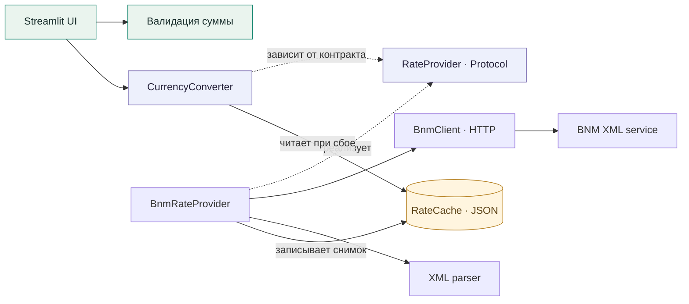
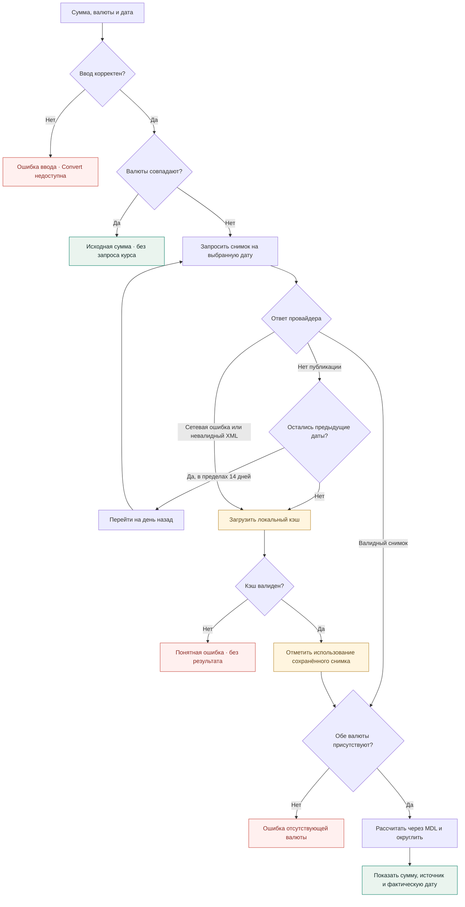
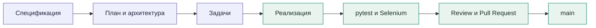

<div align="center">

# 💱 Currency Converter

### Лабораторная работа №3 · Spec-Driven Development

Конвертер валют с официальными курсами Национального банка Молдовы, прозрачными расчётами и поддержкой работы без сети.


**MDL · EUR · USD · RON · GBP · UAH**

[Быстрый запуск](#quick-start) · [Архитектура](#architecture) · [SOLID](#solid) · [Тестирование](#testing) · [SDD и Git](#workflow)

</div>

---

## О проекте

Веб-приложение переводит суммы между шестью валютами по официальному XML-сервису [National Bank of Moldova](https://www.bnm.md/en/official_exchange_rates). Пользователь вводит сумму, выбирает валюты и дату, а затем видит результат, применённый курс, источник и фактическую дату данных.

Проект демонстрирует полный путь от спецификации до реализации и автоматических проверок. Интерфейс построен на **Python + Streamlit**, визуальное оформление — на **CSS и HTML**. Надписи в самом приложении — на английском.

> **Последняя проверка · 04.11.2026:** полный запуск `pytest` завершился с результатом **114 passed за 69,18 секунды**: 110 unit/integration и 4 Selenium E2E. Это результат локального запуска, а не статус непрерывной проверки CI.

## Возможности

| Возможность | Поведение |
| :--- | :--- |
| 💱 Прямая и обратная конвертация | MDL ↔ иностранная валюта, а также пары вроде USD → EUR |
| 🧮 Точные десятичные вычисления | `Decimal`, нормализация `Value / Nominal`, округление `ROUND_HALF_UP` |
| 📅 Выбор даты | Сегодня по умолчанию; можно запросить исторические курсы |
| ↩️ Поиск предыдущего курса | Если публикации нет, проверяются предыдущие даты — до 14 дней назад |
| 💾 Постоянный кэш | Последний сохранённый валидный снимок доступен после перезапуска |
| 📴 Работа без сети | Используется сохранённый снимок с предупреждением и его реальной датой |
| ✅ Проверка ввода | Пустые, нулевые, отрицательные, некорректные суммы и NaN/Infinity отклоняются |
| ⇄ Обмен валют | Swap меняет исходную и целевую валюты; изменение полей очищает старый результат |
| 📱 Адаптивный интерфейс | Светлая тема, отдельная карточка результата, пояснения и различимые состояния ошибок |

Регистрация, сервер базы данных и платёжные операции не требуются.

<a id="quick-start"></a>

## Быстрый запуск

Понадобятся **Python 3.11+** и Git. Для Selenium-тестов также нужны **Google Chrome** и совместимый ChromeDriver. Проверка проекта выполнялась на Windows с Python 3.13.

### 1. Получить проект

```powershell
git clone https://github.com/VadimSiminenco/lab3-currency-converter-sdd.git
cd lab3-currency-converter-sdd
```

### 2. Создать окружение и установить зависимости

```powershell
py -m venv .venv
.\.venv\Scripts\python.exe -m pip install -r requirements.txt
```

### 3. Открыть приложение

```powershell
.\.venv\Scripts\python.exe -m streamlit run app.py
```

Открой адрес из терминала — обычно [localhost:8501](http://localhost:8501). Для остановки нажми `Ctrl+C` в терминале. Активация виртуального окружения для этих команд не нужна.

<details>
<summary><strong>Что проверить при первом запуске</strong></summary>

1. Введи `100`, выбери USD → MDL и нажми **Convert Currency**.
2. Проверь сумму, источник и дату в карточке результата. Реальный курс зависит от выбранной даты.
3. Нажми **Swap currencies** и выполни обратную конвертацию.
4. Введи `0`, `-5`, `abc` или `NaN`: появится ошибка, кнопка конвертации будет недоступна.
5. Выбери одинаковые валюты: сумма вернётся без запроса курсов и без округления.
6. Измени сумму после конвертации: старый результат должен исчезнуть.
7. После успешного получения данных перезапусти приложение без сети: при наличии валидного кэша оно покажет сохранённый курс и его дату.

Запрос в выходной не обязан давать пустой ответ BNM. Для воспроизводимой проверки поиска предыдущей даты используются тестовые провайдеры.

</details>

<a id="architecture"></a>

## Архитектура

UI, валидация, конвертация, HTTP, парсинг и хранение выделены в отдельные модули. Порт `RateProvider` отделяет расчётную логику от способа получения курсов.



Стрелки показывают зависимости и роли компонентов. Создание реального клиента, кэша и провайдера выполняет фабрика `get_converter()` в UI-модуле. Запись кэша находится в BNM-провайдере, чтение при сбое — в конвертере.

| Компонент | Ответственность | Исходный код |
| :--- | :--- | :--- |
| Представление | Виджеты, состояние, результат и предупреждения | [streamlit_app.py](src/app/ui/streamlit_app.py), [styles.css](src/app/ui/styles.css) |
| Валидация | Проверка и разбор суммы | [validation.py](src/domain/validation.py) |
| Конвертер | Формула, одинаковые валюты, поиск даты и offline-fallback | [conversion.py](src/domain/conversion.py) |
| Контракт курсов | Один метод `get_rates(date)` | [ports.py](src/domain/ports.py) |
| BNM-адаптер | Связь клиента, парсера и сохранения снимка | [bnm_provider.py](src/api/bnm_provider.py) |
| HTTP-клиент | Запрос XML, таймауты и сетевые ошибки | [bnm_client.py](src/api/bnm_client.py) |
| XML-парсер | Разбор `ValCurs`, даты, `CharCode`, `Nominal`, `Value` | [xml_parser.py](src/parsing/xml_parser.py) |
| Хранилище | Проверка, чтение и сохранение JSON-кэша | [rate_cache.py](src/cache/rate_cache.py) |

## Как принимается решение о курсе



Если используется предыдущая дата или кэш, приложение сообщает об этом. Отсутствующую валюту нельзя молча заменить другой. При одинаковых валютах отображаемая дата — выбранная пользователем, поскольку официальный курс не запрашивался.

## Математика конвертации

BNM задаёт стоимость некоторого количества единиц валюты в MDL. Сначала значение нормализуется:

```text
rate_per_unit_mdl = Value / Nominal
```

После этого для любой пары поддерживаемых валют используется одна формула:

```text
result = amount × source_rate_mdl / target_rate_mdl
```

Для MDL базовый курс равен `1`. Вычисления выполняются через `Decimal`. Итог округляется по `ROUND_HALF_UP` до двух знаков; положительные результаты меньше `0.01` — до четырёх. При одинаковых валютах возвращается исходная сумма. Справочный курс за единицу отображается отдельно с округлением до четырёх знаков.

> **Пример из тестовых данных, не текущая котировка:** при USD = `18.1250 MDL` сумма `100 USD` даёт `1812.50 MDL`. Если `Nominal = 10`, `Value = 4.3500`, курс за одну единицу равен `0.4350 MDL`.

<a id="solid"></a>

## SOLID — применение в исходном коде

| Принцип | Как применён | Граница реализации |
| :--- | :--- | :--- |
| **S · Single Responsibility** | Представление, валидация, HTTP, XML и кэш выделены в модули | Конвертер объединяет расчёт и оркестрацию fallback; BNM-адаптер также инициирует сохранение |
| **O · Open/Closed** | Конвертер принимает `RateProvider`; новый источник можно подключить без изменения формулы | Другой провайдер должен отдельно обеспечивать нужное сохранение снимка |
| **L · Liskov Substitution** | Общий контракт возвращает `RateSnapshot` или `None`; BNM-провайдер имеет контрактные тесты | Тесты одного реального адаптера не доказывают поведение всех будущих провайдеров |
| **I · Interface Segregation** | Порт содержит только `get_rates(target_date)` | В интерфейс не включены HTTP, парсинг или UI |
| **D · Dependency Inversion** | Расчётная логика зависит от абстракции источника вместо HTTP-клиента | Применён частично: зависимость от конкретного `RateCache` сохраняется |

`@runtime_checkable` позволяет проверить наличие структуры протокола во время выполнения. Он не заменяет тесты возвращаемых значений и поведения провайдера.

<a id="testing"></a>

## Автоматическое тестирование

### Установка и запуск

```powershell
.\.venv\Scripts\python.exe -m pip install -r requirements-dev.txt
.\.venv\Scripts\python.exe -m pytest -q
```

Отдельные наборы:

```powershell
# Unit + integration
.\.venv\Scripts\python.exe -m pytest tests/unit tests/integration -q

# Selenium E2E в headless Chrome
.\.venv\Scripts\python.exe -m pytest tests/e2e -q
```

| Набор | Что проверяет | Последний результат |
| :--- | :--- | :---: |
| Unit + integration | Валидация, формулы, округление, XML, Nominal, кэш, ошибки, даты, BNM-контракт и взаимодействие модулей | **110 passed** |
| Selenium E2E | Невалидные суммы и блокировка Convert; результат, дата и источник; очистка старого результата; Swap | **4 passed** |
| Полный запуск | Все перечисленные наборы одним вызовом | **114 passed** |

Проверка выполнена **04.11.2026** для коммита реализации и тестов `c580ee2`. Продолжительность зависит от компьютера и запуска Chrome; количество тестов может измениться при развитии проекта.

Данные курсов в тестах берутся из фикстур и подменённых провайдеров. Постоянные проверки не требуют доступности живого BNM. Selenium Manager при первом запуске может использовать сеть для получения совместимого драйвера. Unit/integration-тесты используют временные файлы кэша там, где проверяется сохранение.

<details>
<summary><strong>Границы покрытия и тестовый режим UI</strong></summary>

- Четыре Selenium-теста не включают отдельные браузерные сценарии offline и поиска предыдущей даты. Эти правила проверяются на уровне Python.
- Персистентность кэша проверяется созданием нового экземпляра хранилища, а не отдельным запуском операционной системы или браузера.
- В UI предусмотрены переменные окружения `CONVERTER_TEST_FIXTURE` и `CONVERTER_TEST_OFFLINE_CACHE` для детерминированных сценариев. При обычном запуске их нужно оставить незаданными, чтобы использовался BNM.
- Постоянный набор не является доказательством отсутствия любых ошибок и не даёт основания заявлять 100% code coverage: отчёт покрытия не формировался.

</details>

<a id="workflow"></a>

## Spec-Driven Development и Git

Требования и план находятся в репозитории рядом с кодом. Они определяют поведение приложения и критерии приёмки.



| Артефакт | Назначение |
| :--- | :--- |
| [constitution.md](.specify/memory/constitution.md) | Принципы и ограничения проекта |
| [spec.md](specs/001-currency-converter/spec.md) | Функциональные требования и сценарии |
| [plan.md](specs/001-currency-converter/plan.md) | Технический план и архитектура |
| [tasks.md](specs/001-currency-converter/tasks.md) | Задачи и критерии их выполнения |
| [quickstart.md](specs/001-currency-converter/quickstart.md) | Исходная инструкция проверки |
| [data-model.md](specs/001-currency-converter/data-model.md) | Модель данных |
| [official-rate-feed.md](specs/001-currency-converter/contracts/official-rate-feed.md) | Контракт источника курсов |

История реализации разделена по веткам:

- `specs/currency-converter` и `specs/add-oop-selenium` — подготовка требований;
- `feature/implementation` — приложение;
- `testing` — автоматические тесты;
- PR **testing → feature/implementation**, затем **feature/implementation → main** — проверка и объединение работы.

Реализация и тесты объединены в `main` через [PR #3](https://github.com/VadimSiminenco/lab3-currency-converter-sdd/pull/3) и [PR #4](https://github.com/VadimSiminenco/lab3-currency-converter-sdd/pull/4). Изменения документации оформляются отдельным PR.

В разработке и проверке использовались **Google Antigravity** и **OpenAI Codex**. Требования к отчёту об инструментах и моделях следует сверять с заданием преподавателя.

<details>
<summary><strong>Структура проекта</strong></summary>

```text
lab3-currency-converter-sdd/
├── app.py                       # Точка входа Streamlit
├── README.md
├── requirements.txt             # Зависимости приложения
├── requirements-dev.txt         # pytest и Selenium
├── pytest.ini
├── .streamlit/config.toml       # Светлая тема и настройки
├── .specify/memory/constitution.md
├── specs/001-currency-converter/ # SDD-артефакты
├── data/
│   └── .gitkeep                 # rates_cache.json создаётся при работе
├── src/
│   ├── api/                     # HTTP и BNM-адаптер
│   ├── app/ui/                  # Streamlit и styles.css
│   ├── cache/                   # JSON-хранилище
│   ├── config/                  # Валюты, URL, таймауты
│   ├── domain/                  # Модели, порт, валидация, конвертация
│   └── parsing/                 # XML-парсер
└── tests/
    ├── fixtures/                # Воспроизводимые XML и JSON
    ├── unit/
    ├── integration/
    └── e2e/                     # Selenium + pytest
```

Рабочий кэш `data/rates_cache.json` и виртуальное окружение `.venv` исключены из Git. Тестовые примеры хранятся в `tests/fixtures`.

</details>

---

<div align="center">

**Официальный источник · Проверяемые расчёты · Прозрачная дата данных**

Учебный проект: справочные курсы могут отличаться от условий банка или обменного пункта; комиссии не рассчитываются.

Диаграммы написаны на Mermaid и [отображаются непосредственно в GitHub Markdown](https://docs.github.com/en/get-started/writing-on-github/working-with-advanced-formatting/creating-diagrams).

</div>
